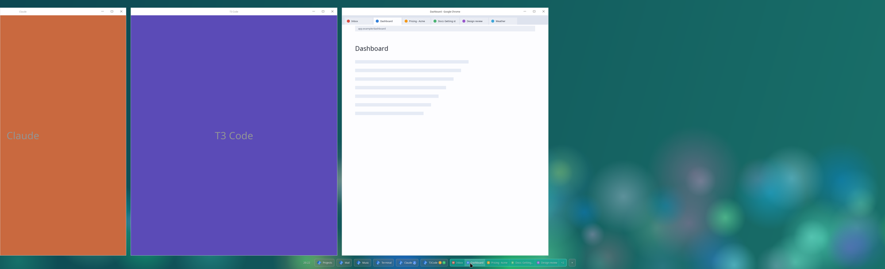
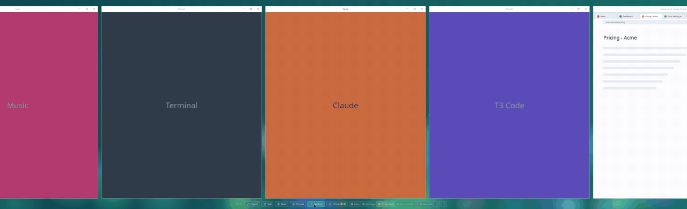
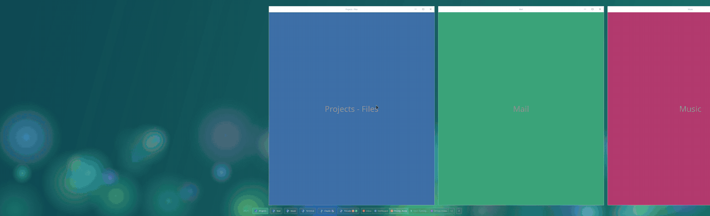
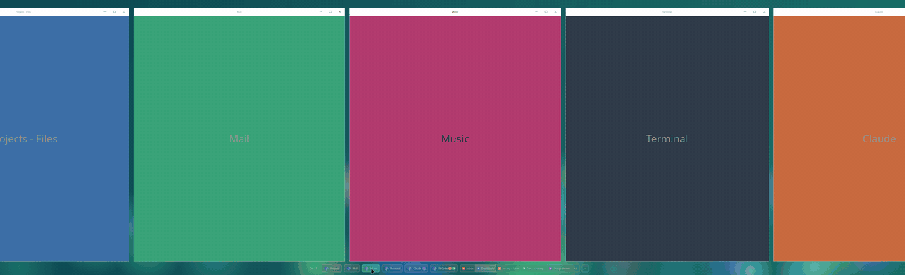
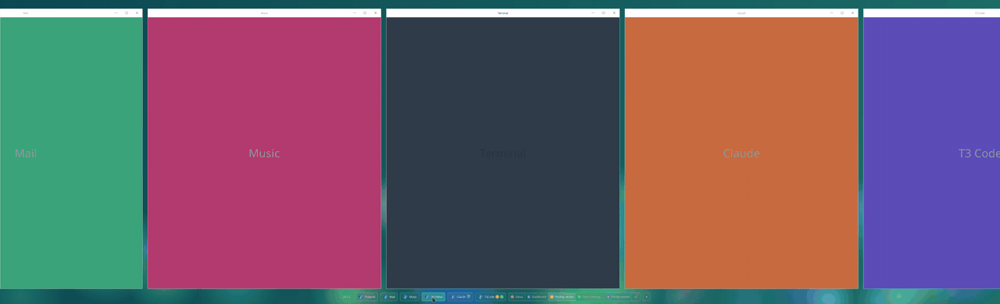
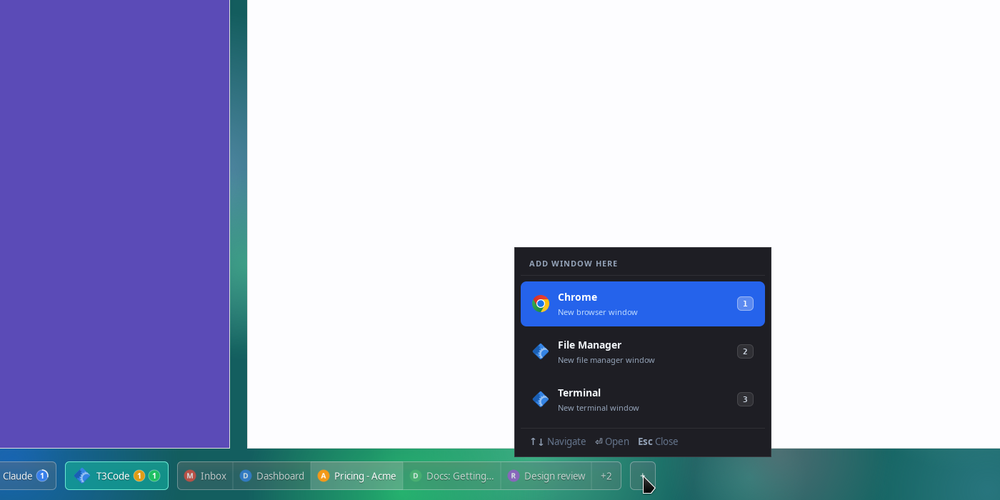

<div align="center">

```
 ████  █       ███   ████    ████  █      █████  ████   █████
█      █      █   █  █   █  █      █        █    █   █  █
 ███   █      █   █  ████    ███   █        █    █   █  ████
    █  █      █   █  █          █  █        █    █   █  █
████   █████   ███   █      ████   █████  █████  ████   █████

  [ Files ][ Mail ][ Music ][ Terminal ][ Claude ][ T3 Code ] ───────────▶
          one endless strip of windows. no stacking. just slide.
```

**A scrolling desktop for Linux (X11).** Windows sit side by side in one horizontal strip. Scroll along it, and click
the taskbar to bring any window to the middle.



</div>

> Made with a lot of help from AI, hence the name. It works on the author's machine (Deepin 25, `kwin_x11`, one
> ultra-wide monitor) and is tested with 251 unit tests plus an isolated test desktop. It has not been tried on other
> setups. See [Status](#status).

## What it does

| | |
|---|---|
| **Chrome tabs as a button group** | Each Chrome window shows its tabs as buttons in the taskbar. Click a tab to switch to it. [Jump to it](#chrome-tabs-as-a-button-group) |
| **Thread badges** | Orange, green and blue count badges on the Claude Code and T3 Code boxes: waiting for you, done, working. [Jump to it](#thread-badges-for-claude-code-and-t3-code) |
| **Scrolling strip** | Super + mouse wheel scrolls the desktop. Windows never overlap. |
| **Smart taskbar** | One box per window, in the same order as the windows. Drag a box to reorder. |
| **Resize by the gap** | Drag the gap between two windows to resize the window on its left. |
| **Forgotten-window shake** | A window minimised for 30 minutes shakes its box now and then. |
| **Clock, volume, sound output** | Time, a volume slider and a one-click output switch, left of the boxes. |
| **Sidebar friendly** | Windows fold away under a gap beside a floating sidebar on the right. |
| **Safe by design** | Nothing survives a reboot. A guardian puts every window back after a crash. |

## Chrome tabs as a button group

<div align="center">

</div>

With the small **sdesk tabs** extension, a Chrome window's box becomes a group of buttons, one for each tab:

- Each button has the page icon and the page title, cut to 15 characters. The tab on screen is lit.
- A click on another tab switches Chrome to that tab and brings the window to the middle.
- At most 5 tabs show: the active tab and the most recent ones, in tab-strip order. The rest folds into a **+N** button.
- Hover a button to see the full title.
- Without the extension, or while Chrome is closed, a Chrome window is one box that shows the active tab.

Install the extension once: `chrome://extensions` > **Developer mode** > **Load unpacked** > the
[`chrome-extension`](chrome-extension) folder. It talks to SlopSlide over `127.0.0.1` only, and SlopSlide refuses any
connection that does not come from a browser extension. [Details](docs/DETAILS.md#chrome-tabs-as-a-button-group)

[MP4 of this clip](docs/media/chrome-tab-group.mp4). The video uses a stand-in Chrome window with invented tabs
([`lab/demo_chrome.py`](lab/demo_chrome.py)).

## Thread badges for Claude Code and T3 Code

<div align="center">

</div>

| Badge | Meaning |
|---|---|
| 🟠 orange | Threads that wait for you |
| 🟢 green | Threads that finished since you last looked. A click on the box marks them as seen. |
| 🔵 blue | Threads that work. A light runs slowly round the edge. |

SlopSlide reads only the states the programs keep themselves: the session files of Claude Code (`~/.claude/sessions`) and
the database of T3 Code (read-only). "Done" is made from the change busy to idle while SlopSlide runs.
[Details](docs/DETAILS.md#thread-badges-claude-code-t3-code)

[MP4 of this clip](docs/media/thread-badges.mp4). The video uses invented threads.

## Scrolling and focusing

<div align="center">

</div>

- **Super + mouse wheel** scrolls the strip. The plain wheel and Ctrl + wheel stay with the apps.
- You can scroll until the first or last window is in the middle of the screen.
- A click on a taskbar box brings the window to the middle. A click on the box that is already active minimises it.
  Another click brings it back to the exact place it had.

<div align="center">

</div>

[MP4: scroll](docs/media/scroll.mp4) · [MP4: focus and minimise](docs/media/focus-and-minimise.mp4)

## Reorder and resize

<div align="center">

</div>

Drag a taskbar box and it lifts out as a tilted ghost. A gap glides to the drop spot, and the desktop shows the same
move. The order of the boxes is always the order of the windows. You can also drag a window by its title bar; the other
windows slide aside and an outline shows where it will land.

<div align="center">

</div>

Drag the gap between two windows to resize the window on its left. The windows to the right move along. This works for
every window, also for apps without a border of their own (Chrome, Electron apps). All windows keep one height.

[MP4: reorder](docs/media/reorder-taskbar.mp4) · [MP4: resize](docs/media/resize-by-the-gap.mp4)

## Forgotten windows shake

<div align="center">

</div>

SlopSlide notes when a window was minimised. After 30 minutes its box shakes and lights up for a moment, then again every
5 minutes, until you bring the window back or close it. (The video runs with `--nag-after 1`, one minute.)
Change it with `--nag-after` and `--nag-every`, or switch it off with `--nag-after 0`.

[MP4 of this clip](docs/media/minimised-window-shake.mp4)

## Add a window where you want it

<div align="center">

</div>

Right-click the gap between two windows, or click the **+** at the end of the taskbar. A menu offers Chrome, a file
manager and a terminal (you can change the list). The slot opens at that exact place, the app starts, and its window
lands in it. Right-click a taskbar box for **Close** or **Force Quit**. Middle-click a box to close the window.

## Names, icons, clock, volume, sound

- **Names:** a box shows the program name. A file manager shows the folder instead. A Chrome box shows the page title.
- **Clock and sound** sit left of the boxes without a background: the time, a volume slider (drag, click or scroll) and the
  current output. A click on the output switches to the next one and moves what plays along. Right-click picks from a list.
  Middle-click mutes.
- **Battery** sits between the clock and the volume slider: an icon and the percentage for the mouse and for each half of
  a Dygma Defy. Orange at 20% or less, teal with a bolt while charging, dimmed with a dash when a device cannot be read.
  Hover for the exact values and the time of the last read. `--battery off` hides it. See below for the one-time setup.
- **Sidebar friendly:** with a floating sidebar on the right, the strip uses the area left of it. Windows on the right
  fold away under a gap in front of the sidebar.

## Install

Needs Linux with X11, a window manager that follows the EWMH standard (tested with `kwin_x11` on Deepin 25), Python 3 (developed on 3.12),
and these packages:

```bash
sudo apt install python3-gi gir1.2-gtk-3.0 python3-cairo pulseaudio-utils
git clone https://github.com/zenixbe/slopslide.git
cd slopslide
python3 -m venv --system-site-packages .venv
.venv/bin/pip install python-xlib pytest
./run.sh            # start. Ctrl+C stops and puts every window back
```

`./run.sh` also switches Deepin's own dock off while it runs. On another desktop, use
`.venv/bin/python -m sdesk --bar top` (leaves the dock alone). A desktop icon to start and stop it:
`launcher/install.sh`. The icon and `sdesk-toggle` also read your own options from `~/.config/sdesk/args`
(for example `--sound-match logitech`).

### Battery of the mouse and the Dygma Defy

- **Dygma Defy:** read over its serial port (`/dev/serial/by-id/usb-DYGMA_DEFY_*`). Your user must be in the `dialout`
  group. SlopSlide asks once a minute, closes the port at once, and skips the read while Bazecor has the port open.
- **Logitech mouse** (through its USB receiver, HID++): the receiver is only readable by root until you install the udev
  rule in `udev/`. Run these commands once, from the repo folder:

  ```bash
  sudo cp udev/70-sdesk-logitech.rules /etc/udev/rules.d/
  sudo udevadm control --reload-rules
  sudo udevadm trigger --subsystem-match=hidraw --action=change
  ```

  Then check: `getfacl /dev/hidraw*` shows your user with `rw` on the receiver. If not, unplug the receiver and plug it in
  again. To undo: `sudo rm /etc/udev/rules.d/70-sdesk-logitech.rules` and run the two `udevadm` commands again.

## Safety: nothing survives a reboot

- SlopSlide never starts by itself, and it changes no Deepin or kwin setting. A reboot always gives a normal desktop.
- After a normal exit, every window goes back where it was.
- After a crash or `kill -9`, a small guardian process puts every window back within a second.
- Panic button from any terminal: `./run.sh --restore`.

## Status

- Built for one monitor. Windows on other virtual desktops, fullscreen windows and dialogs are left alone.
- Windows move over X, so a very fast scroll can show a little tearing without a compositor.
- The videos come from an isolated test desktop without a compositor, so there is no frosted glass in them. With the
  compositor on (Deepin "best visuals"), the boxes are translucent and blurred.
- The Chrome tab group needs the extension; without it Chrome shows as one box.

## Development

```bash
.venv/bin/python -m pytest                 # 251 tests, no display needed
lab/start_lab.sh                           # an isolated test desktop (Xvfb :99 + its own kwin_x11)
.venv/bin/python lab/record_media.py setup # open demo windows and SlopSlide in the lab
.venv/bin/python lab/record_media.py       # record the videos and screenshots in docs/media
lab/stop_lab.sh
```

The lab never touches the real session. More in [docs/DETAILS.md](docs/DETAILS.md): every option, how it works, and
what happens after a crash.

## License

[MIT](LICENSE)
